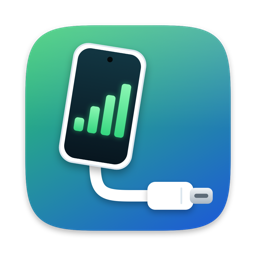
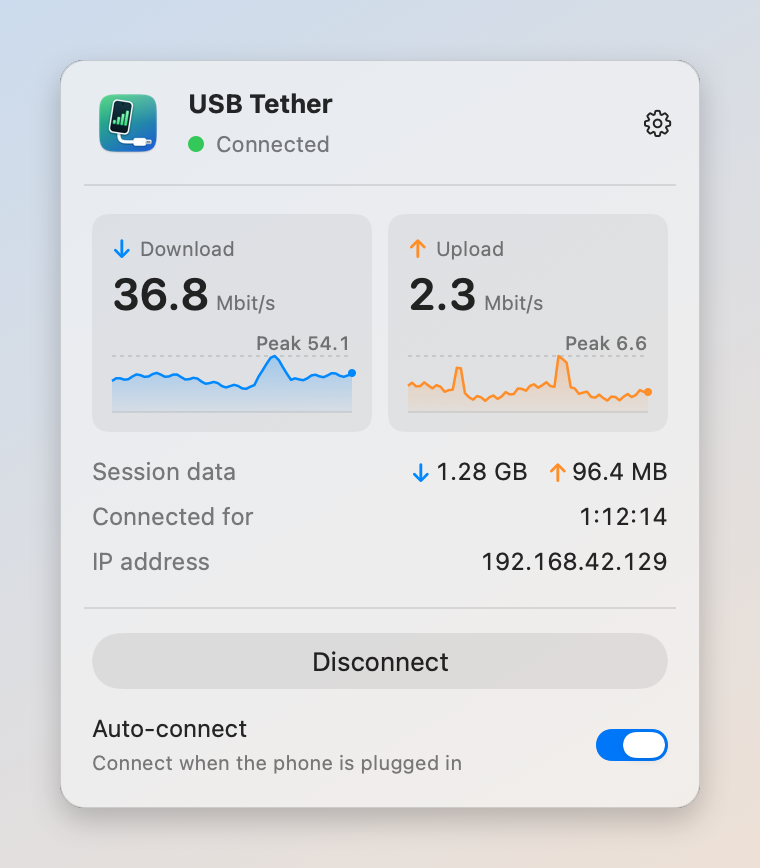
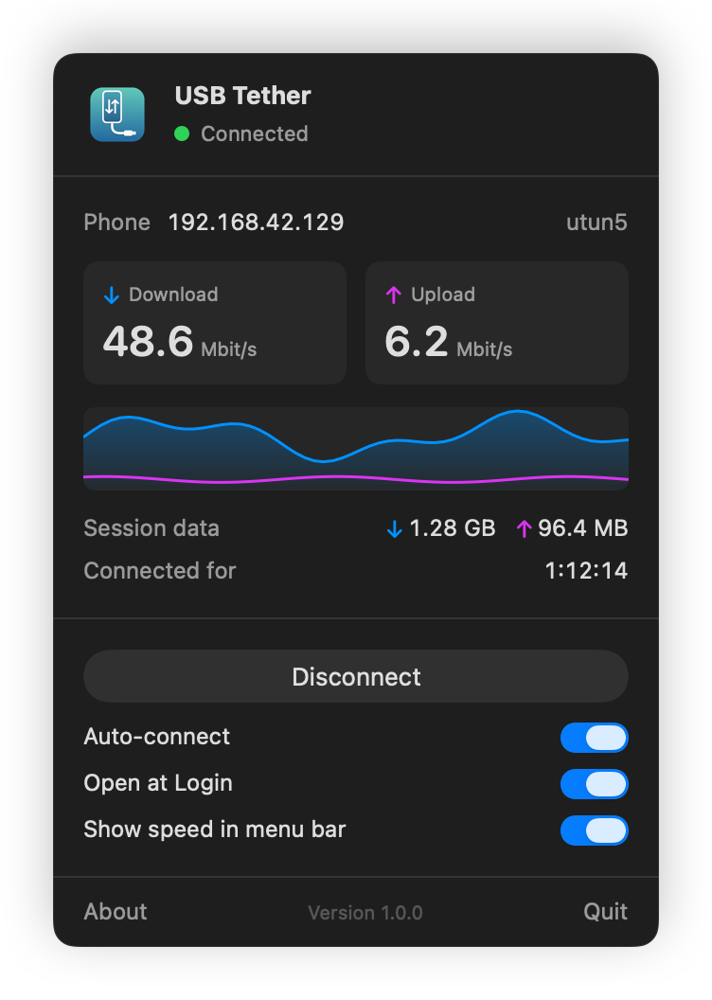
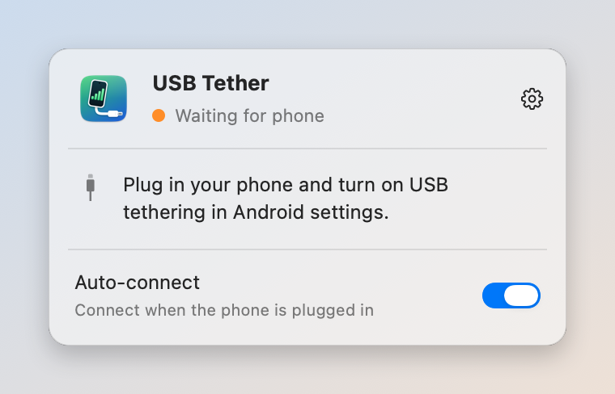
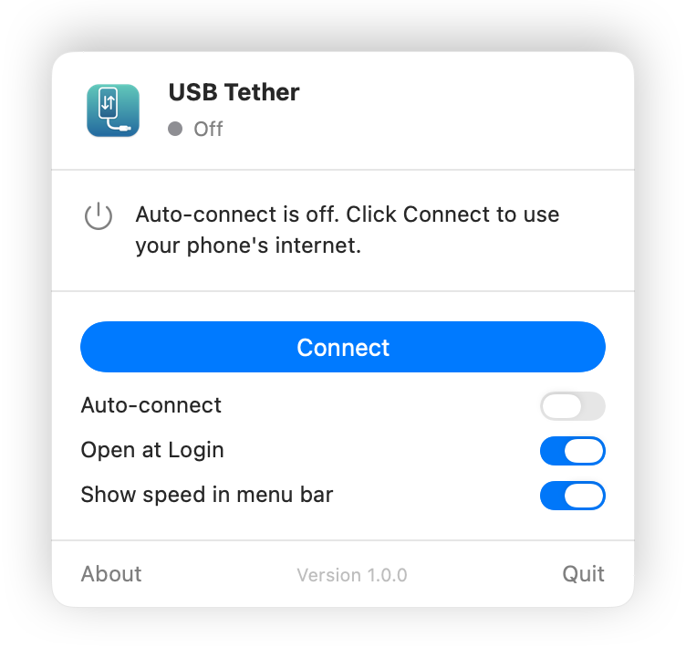

<p align="center">
  
</p>

<h1 align="center">USB Tether</h1>

<p align="center">
  Use your Android phone's internet on your Mac over a USB cable.<br>
  No kernel extensions. No SIP changes. Works on Apple Silicon and Intel.
</p>

<p align="center">
  <a href="../../releases/latest"></a>
  
  
  <a href="LICENSE"></a>
</p>

<p align="center">
  
  
</p>

## Why

Android shares its connection over USB with a protocol called RNDIS. macOS has no RNDIS driver, and the old kernel-extension drivers no longer load on Apple Silicon. USB Tether talks to the phone from a normal background service instead, so it works on current Macs without lowering any security settings.

## Features

- **Plug in and go.** Auto-connect starts tethering as soon as the phone is plugged in with USB tethering on.
- **Menu bar app.** Live download and upload speed, a 60-second speed graph, data used this session, and connection time.
- **One password, once.** The background service is installed by the installer. You never type a password to connect.
- **Leaves your Mac as it found it.** Routes and DNS are removed when the phone disconnects or the service stops.
- **Universal.** One download for Apple Silicon and Intel Macs.

## Install

1. Download **USB-Tether-1.0.0.dmg** from the [latest release](../../releases/latest).
2. Open the disk image and double-click **USB Tether.pkg**.
3. USB Tether opens in the menu bar when the installer finishes.

**If macOS blocks the installer.** Version 1.0.0 is not signed with an Apple Developer ID yet. Right-click **USB Tether.pkg** and choose **Open**, then click **Open** again. Or open **System Settings → Privacy & Security** and click **Open Anyway**. You only do this once.

To check the download, compare its SHA-256 with the `.sha256` file on the release page:

```bash
shasum -a 256 -c USB-Tether-1.0.0.dmg.sha256
```

## Use

1. Connect the phone to the Mac with a USB data cable.
2. On the phone, turn on **USB tethering** (usually **Settings → Network & internet → Hotspot & tethering**).
3. The menu bar icon turns solid when you are online.

<p align="center">
  
  
</p>

Turn **Auto-connect** off if you want to connect only when you click **Connect**. The gear menu has **Open at Login** and **Show Speed in Menu Bar**.

## Uninstall

Open the disk image and double-click **Uninstall USB Tether.command**, then enter your admin password. It removes the app, the background service, its log, and the installer receipt.

## Requirements

- macOS 13 Ventura or later.
- An Android phone that tethers over **RNDIS**. Most phones do. Some recent phones use **NCM** instead, which is not supported yet.
- A USB cable that carries data, not a charge-only cable.

## Troubleshooting

**The menu says "Waiting for phone" and nothing happens.**
Check that USB tethering is on in the phone's settings. Unplug and replug the cable. Try another cable or port.

**The menu says "Service not running".**
Reinstall USB Tether from the disk image. To see why the service stopped, read its log:

```bash
cat /var/log/macostether.log
```

**Another tethering app is installed.**
Only one tethering service can use the phone at a time. Remove the other app first.

Still stuck? [Open an issue](../../issues/new/choose) with your macOS version, Mac model, phone model, and the log.

## How it works

```
Android phone ──USB (RNDIS)──▶ macostether (root service) ──utun──▶ macOS network
                                      ▲
                                      │ local socket
                               USB Tether (menu bar app)
```

1. The service finds the phone on USB with libusb and starts an RNDIS session.
2. It asks the phone for an address with DHCP.
3. It creates a `utun` network interface and moves packets between the phone and the Mac.
4. It adds two routes (`0.0.0.0/1` and `128.0.0.0/1`) through the phone and sets DNS. Your normal default route stays untouched and comes back the moment the phone disconnects.

The menu bar app talks to the service over `/var/run/macostether.sock`. Only root and the logged-in user can connect to it.

## Build from source

You need the Xcode Command Line Tools (`xcode-select --install`).

```bash
# Development build (uses Homebrew libusb)
brew install libusb
make
make test

# Install the development build on this Mac
sudo make install

# Release build: universal .pkg inside a .dmg, libusb built from pinned source
make dist
```

`make dist` writes `build/USB-Tether-<version>.dmg` and its `.sha256`.

### Command-line options

The service can also run by hand for debugging. Stop the installed service first.

```bash
sudo "build/USBTether.app/Contents/MacOS/macostether" --verbose
```

| Flag | Description |
|------|-------------|
| `-w, --watch` | Keep running and connect whenever a phone appears |
| `-n, --no-route` | Do not add routes |
| `-d, --no-dns` | Do not change DNS |
| `-s, --static IP` | Use a static address instead of DHCP |
| `-g, --gateway IP` | Gateway to use with `--static` |
| `-m, --netmask IP` | Netmask (default 255.255.255.0) |
| `-c, --config FILE` | Read settings from FILE |
| `-v, --verbose` | Debug logging |
| `-V, --version` | Print the version |

Settings can also live in `~/.config/macostether/config`. Command-line flags win.

## Contributing

See [CONTRIBUTING.md](CONTRIBUTING.md). Report security problems privately as described in [SECURITY.md](SECURITY.md).

## Credits

USB Tether started as a fork of [android-usb-tether-macos](https://github.com/hknsglm/android-usb-tether-macos) by Hakan Saglam, released under the MIT license.

## License

MIT. See [LICENSE](LICENSE).
