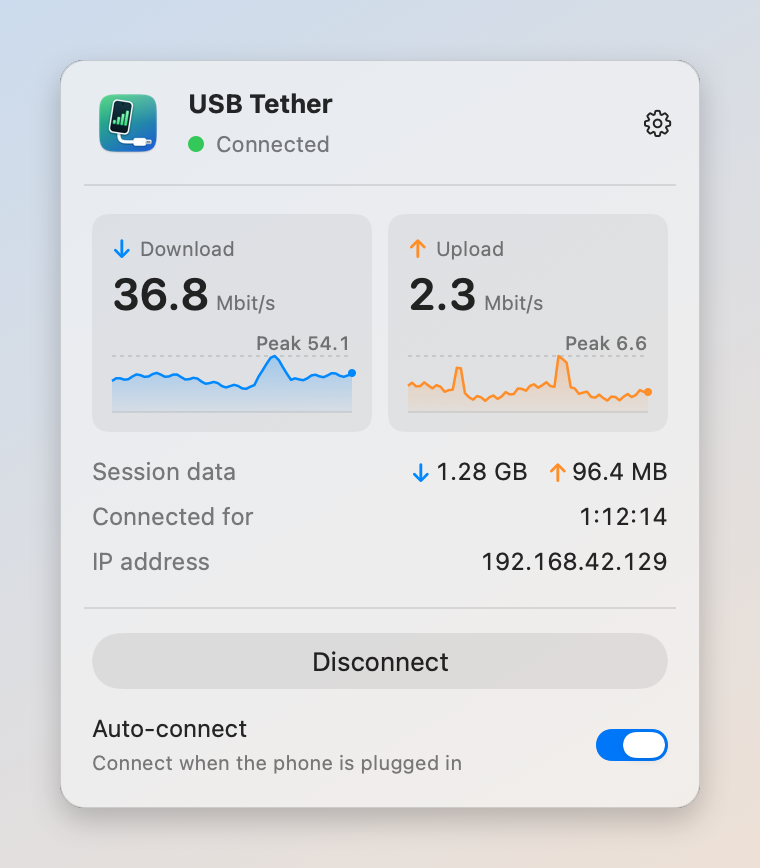

<p align="center">
  
</p>

**USB Tether lets your Mac use your Android phone's internet over a USB cable.** No kernel extensions, no SIP changes, one download for Apple Silicon and Intel.

This is the first release under the USB Tether name.

## Highlights

- **New menu bar app.** Live download and upload speed with a 60-second graph for each, data used this session, connection time, and clear states: connected, waiting for phone, off, and service not running.
- **Plug in and go.** Auto-connect is on by default. Plug in the phone, turn on USB tethering, and you are online.
- **Proper installer.** One disk image with an installer and an uninstaller. Nothing else to install: no Homebrew, no Terminal.
- **Security hardening.** The root service now bounds-checks USB data from the phone, keeps its control socket out of `/tmp`, accepts commands only from root and the logged-in user, and no longer writes files in `/tmp`.

## Install

1. Download **USB-Tether-1.0.0.dmg** below.
2. Open it and double-click **USB Tether.pkg**.
3. USB Tether opens in the menu bar when the installer finishes.

This release is not signed with an Apple Developer ID yet. If macOS blocks the installer, right-click **USB Tether.pkg** and choose **Open**, or click **Open Anyway** in **System Settings → Privacy & Security**. You only do this once.

**Requires** macOS 13 Ventura or later and an Android phone that tethers over RNDIS.

**Upgrading from macOs_tether?** Just run the installer. It replaces the old app.

## Uninstall

Double-click **Uninstall USB Tether.command** in the disk image.

## Verify the download

```bash
shasum -a 256 -c USB-Tether-1.0.0.dmg.sha256
```

Full list of changes: [CHANGELOG.md](https://github.com/ashahinL/usb-tether/blob/v1.0.0/CHANGELOG.md).
